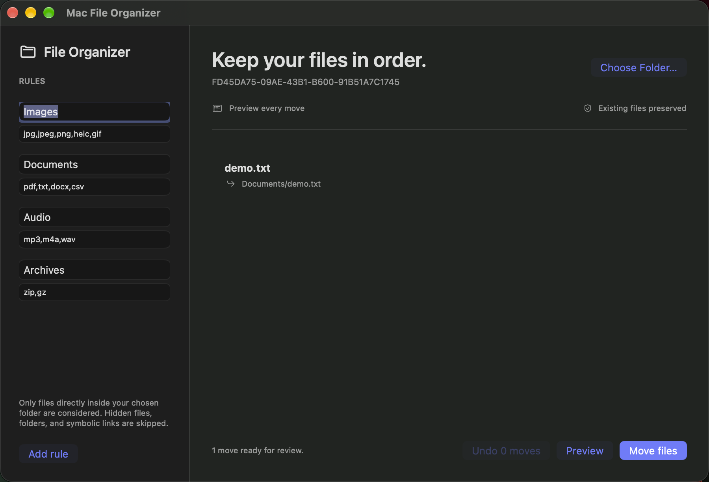

# Mac File Organizer

A sandboxed macOS utility that previews every file move and keeps a recoverable undo journal.

[](https://github.com/DawoodAamir/Mac-File-Organizer/actions/workflows/ci.yml)

[](LICENSE)



## Features

- Choose a folder once and restore access through a security-scoped bookmark.
- Organise its immediate files using editable extension rules.
- Resolve filename collisions with numbered names and skip hidden files, folders, and symbolic links.
- Reject changed files and undo without overwriting the original location.

## Run locally

Open **Mac File Organizer.xcodeproj** and run the shared scheme on macOS. Choose a test folder, set folder names and comma-separated extensions, and click Preview. Review each destination, then confirm Move files. Undo restores unchanged files to their original locations.

Only immediate files are considered; this utility does not recursively reorganise a disk. File hashes detect content changes between preview and move and before undo. The journal writes intent before each move so an interrupted run can recover completed operations. Partial failures stop further moves and retain the remaining undo history. Choose the original folder before undoing earlier moves.

Use an empty test folder for your first run. Core tests create disposable fixtures and verify collisions, changes, symlink rejection, and non-overwriting undo. The app uses the macOS sandbox with user-selected read/write access, without Full Disk Access.

## Structure

- `Sources/Core`: domain logic, also exposed through a Swift Package for tests.
- `Sources/App`: native SwiftUI screens and platform integrations.
- `Tests/Core`: domain regression tests.
- `Tests/UI`: native workflow tests with isolated saved state and retained screenshots.
- `Resources`: assets, app icon, and platform configuration.

## Verification

Requires Xcode 15 or newer for these sources; local checks use the installed Xcode toolchain. No developer team is committed. Simulator builds need no personal signing identity. A physical device requires your own signing and capabilities.

```sh
swift test
swift test -c release
bash Scripts/test-ui.sh
```

CI runs the core tests, a Release build, and native workflow tests. The reference APIs have separate backend checks. See [verification notes](Docs/Verification.md) for the tested environment and remaining device checks.

## Privacy and contribution

The selected folder bookmark, rules, and undo paths remain local. File contents are hashed on device and never uploaded. No network requests or analytics.

See [PRIVACY.md](PRIVACY.md), [CONTRIBUTING.md](CONTRIBUTING.md), and [LICENSE](LICENSE). All example people, assignments, accounts, and order identifiers are fictional. No App Store seller account is connected to this project.
